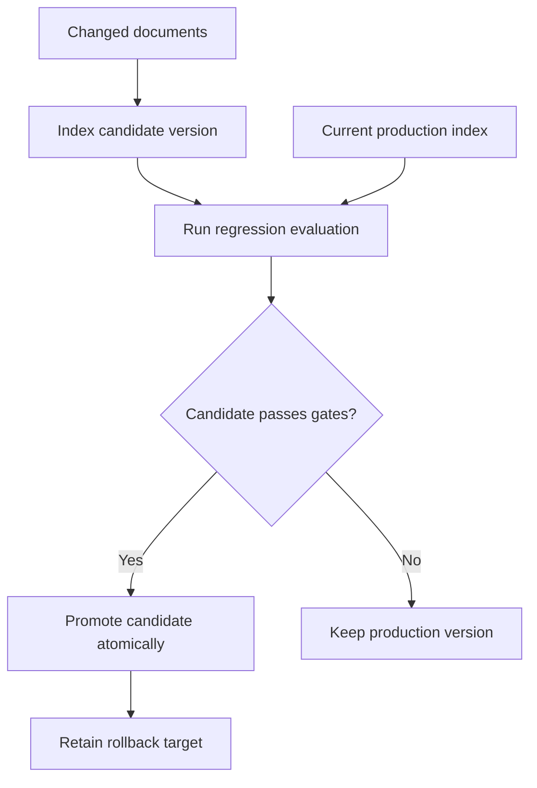

# Enterprise RAG at Scale — Case Studies, Design Patterns, and Our Roadmap

> Learning notes from publicly described RAG deployments at **Ring, Microsoft, Audi, and KDDI**. The goal is not to copy their technology stacks: understand the **problem → why it breaks → technique → trade-off**, then decide whether it helps our [Berkshire RAG project](../README.md).
>
> **Evidence labels:** **Reported** = described by the cited company's case study; **Proposed** = an idea for our repository, not implemented or benchmarked here. Product claims and performance numbers are source-reported and have not been independently reproduced.

## 1. What changes when RAG becomes an enterprise system?

Our current system answers questions about a **Berkshire Hathaway annual report** using extraction, structure-aware chunking, Pinecone dense + sparse search, weighted reciprocal rank fusion (RRF), optional cross-encoder/blended reranking, and source-grounded answers.

Enterprise deployments introduce additional failure modes:

| Dimension | Small document RAG | Enterprise failure mode |
|---|---|---|
| Content | A few PDFs indexed manually | Thousands of changes, many data sources |
| Users | One audience | Different regions, teams, and access permissions |
| Correctness | Spot-check a few questions | New content degrades existing answers silently |
| Operations | Rebuild when convenient | Updates without breaking production |
| Latency | One retrieval and generation | Multi-agent routing, huge prompts, multiple services |
| Governance | Document citations | Version, ownership, authorization, auditability |

**Mental model:** Scaling RAG means scaling *knowledge maintenance and quality control*, not merely vector count.

## 2. Real-world case studies and what to learn

### Ring — Centralized, multilingual support knowledge

**Problem:** Customer-support content spans locales; operating separate deployments per locale increases cost and operational complexity.

**Reported approach:**
- Shared Amazon Bedrock Knowledge Base with **`contentLocale` metadata filtering** to retrieve the relevant market's documents.
- S3-triggered ingestion using Lambda; Step Functions coordinate workflows.
- OpenSearch Serverless for vector storage.
- **Daily versioned knowledge bases** and automated evaluation before promotion.
- LLM-based judging as one input to quality gates.
- Benchmarked cross-region latency before centralizing, rather than assuming each locale needed a local stack.

**Reported outcome:** Ring describes coverage across **10 locales/regions** and a **21% reduction in cost for adding each locale**. Figures are company-reported; they are not our measurements.

**Why this works:** *One shared platform* lowers duplicate infrastructure and maintenance; *metadata filters* keep content scoped; *versioned promotion* prevents uncontrolled content changes.

**Trade-offs:** Shared systems need isolation/filters, quota management, and resilience planning. A centralized region can introduce latency or availability concerns.

**Apply to us (proposed):**
1. Attach `document_type`, `product`, `locale`, `version` (when available) to chunks.
2. Support retrieval-time metadata filters.
3. Build a candidate index/namespace, run evaluation, and switch production only when it passes.
4. Test rollback by intentionally indexing a bad document version.

**Source:** [Ring on AWS: global customer support with Bedrock Knowledge Bases](https://aws.amazon.com/blogs/machine-learning/how-ring-scales-global-customer-support-with-amazon-bedrock-knowledge-bases/).

### Microsoft Licensing Navigator — Better source quality before better models

**Problem:** Licensing policies are detailed, conditional, and frequently misunderstood. The wrong *kind* of policy can seem semantically similar to the right one.

**Reported approach:**
- Reviewed and curated a corpus of **nearly 600 documents**.
- Improved **document headers, tables, metadata**, and how documents were structured for retrieval.
- Used question/topic understanding, **Azure AI Search semantic ranking**, and **metadata filters**.
- Added deep links to source evidence and follow-up conversation support.

**Reported outcome:** Microsoft describes **1,000+ questions per week**, **800+ monthly active users**, and roughly **90% faster** preparation of customer responses. These are published case-study figures.

**Why this works:** A reranker cannot reliably repair missing or miscategorized evidence. Good metadata and good document structure constrain the search space *before* ranking.

**Trade-offs:** Curation, content ownership, and metadata governance require effort. Strict filters can accidentally remove the correct result if metadata is wrong.

**Apply to us (proposed):**
1. Create adversarial queries that distinguish similar products/versions/policies.
2. Improve table extraction and source metadata before experimenting with more rerankers.
3. Compare **unfiltered vs metadata-filtered** retrieval on a labeled test set.
4. Report **filter false negatives** as well as retrieval accuracy.

**Source:** [Microsoft Licensing Navigator case study](https://www.microsoft.com/en/customers/story/25413-microsoft-azure-ai-search).

### Audi — Incremental synchronization instead of full re-indexing

**Problem:** A living enterprise knowledge base includes continuously growing internal discussions. Re-reading every document every time wastes resources.

**Reported approach:**
- Initial bulk ingestion of existing discussion content.
- Follow-up **high-watermark synchronization**: track which content has been seen and fetch what changed later.
- Reused components including Azure AI Search and Cosmos DB for the data/synchronization pipeline.

**Reported outcome:** Audi describes rapid rollout of an internal knowledge assistant, with an initial assistant launched in about **two weeks**. This is not a throughput benchmark.

**Why this works:** After the initial import, ongoing work scales closer to the *change rate* rather than the entire corpus.

**Trade-offs and failure cases:**
- A watermark based only on created time can miss **edits and deletions**.
- Failed updates require retry and replay without duplicates.
- A watermark must advance **only after durable processing**.

**Apply to us (proposed):**
1. Store per-document `source_id`, `content_hash`, `last_modified`, and `indexed_version`.
2. Skip unchanged PDFs; re-embed only changed documents.
3. Make upserts idempotent and delete stale vectors from both dense and sparse indexes.
4. Test edits, deletions, interrupted ingestion, and replay after a worker crash.

**Source:** [Audi internal knowledge assistant on Microsoft Azure](https://www.microsoft.com/en/customers/story/24786-audi-ag-azure-ai-foundry).

### KDDI — Measure end-to-end latency, not just retrieval speed

**Problem:** A production agentic RAG application can become slow because of oversized prompts, model/tool orchestration, and repeated retrieval. Manual evaluation cannot keep pace with frequent changes.

**Reported approach:**
- Automated evaluations including LLM-as-judge and sampled document formats.
- Used production log analytics (Google Cloud/ADK tooling) to identify slow steps.
- Refactored **very long prompts (over 800 lines)** into skills/instructions loaded only when needed.
- Simplified unnecessary sub-agent routing and introduced crisp **pass/fail criteria** for critical checks.

**Reported outcome:** KDDI reports **38% lower overall latency**, nearly **18% faster time to first token**, **25% higher groundedness scores**, and **75% less evaluation effort**. These are case-study claims, not independently verified measurements.

**Why this works:** A fast vector database does not help much if most response time is spent planning, sending massive prompts, and calling multiple models.

**Trade-offs:** Dynamic prompt/skill loading adds routing logic. LLM-as-judge can be inconsistent; calibrate against human labels and deterministic checks.

**Apply to us (proposed):**
1. Instrument extraction, embedding, dense retrieval, sparse retrieval, fusion, reranking, prompt assembly, and answer generation separately.
2. Track p50/p95 **end-to-end** latency, not only retrieval latency.
3. Evaluate citation correctness, exact number/unit correctness, and whether the model abstains appropriately.
4. Try agentic retrieval only for cases where a single retrieval demonstrably fails.

**Source:** [KDDI: Optimizing RAG with Google Agent Development Kit](https://cloud.google.com/blog/topics/customers/how-kddi-optimized-rag-performance-with-agent-development-kit).

## 3. Five patterns we should remember

### Pattern A — Metadata-first retrieval

**Problem:** A question about Oracle Database **19c** can retrieve a semantically similar chunk about **26ai**.

**Fix:** Filter eligible chunks by product/version/locale/authorization *before or during search*, then rank the remaining results.

```python
# Illustrative: API and schema depend on the chosen vector store
filters = {"product": "Oracle Database", "version": "19c"}
results = retrieve(query, filters=filters, top_k=20)
```

**What breaks next?** Incorrect or missing metadata can exclude the correct answer. Measure both false inclusions and false exclusions.

### Pattern B — Build, evaluate, promote, roll back

**Problem:** A document or parser update can make a previously correct answer wrong.



**Trade-off:** Temporary duplicate storage and evaluation cost. Prefer predictable rollout over silent regressions.

### Pattern C — Incremental, idempotent ingestion

**Problem:** Reprocessing one million documents every time 100 change wastes money; interrupted updates can leave stale chunks.

**Fix:** Change detection → queue/retry → reprocess affected documents → atomic/version-aware publish.

**What breaks next?** Deletes, out-of-order events, watermark gaps, and partial writes. Use stable document IDs, version markers, and reconciliation jobs.

### Pattern D — Automated evaluation at multiple layers

No single score proves that RAG works.

| Layer | What to measure | Example failure |
|---|---|---|
| Extraction/chunking | Parsed-table fidelity, heading preservation | Revenue loses its year or units |
| Retrieval | Hit@K, Recall@K, MRR, nDCG | Correct dividend-policy chunk is absent |
| Answer | Exact facts, grounding, citations, abstention | Correct chunk found, wrong number stated |
| Operations | p50/p95, error rate, cost, update freshness | Fresh report takes hours to appear |
| Safety | Access-filter correctness | Private document enters public context |

**Important:** An LLM-as-judge helps scale review, but its scores should be tested against human-labeled and deterministic examples.

### Pattern E — Optimize the critical path

**Problem:** Even perfect retrieval is useless if the user waits too long.

```text
Total response time ≈
query understanding + retrieval + reranking + prompt assembly
+ LLM generation + network / orchestration overhead
```

**Fix:** Trace first, then optimize the largest measured contributor. Avoid adding agents and extra model calls without an evaluation-backed reason.

## 4. Our RAG: what's already here vs what's missing?

This is a design backlog **to validate against current code before implementing**. The project may evolve after these notes were written.

| Capability | Current project baseline | Proposed next step | Priority |
|---|---|---|---|
| Structured PDF chunking | Present; section and table handling | Add measured table-fidelity test suite | P0 |
| Dense + sparse retrieval | Present in Pinecone | Keep as baseline | Maintain |
| RRF + blended cross-encoder reranking | Present | Compare per question category | Maintain |
| Retrieval golden dataset | Present | Expand with difficult metadata/version cases | P0 |
| Answer-level evaluation | See [EVALUATION.md](EVALUATION.md) for current coverage | Tighten citations, numbers, units, abstention checks | P0 |
| Document change detection | Not established as full production sync | Content-hash + incremental ingest | P1 |
| Versioned indexing and promotion | Not established | Candidate → eval gate → promote/rollback | P1 |
| Query-time metadata filters | Needs end-to-end verification | Product/version/locale filters | P1 |
| Multi-tenant access control | Not established | Identity-aware ACL enforcement before context assembly | P0 for private enterprise use |
| End-to-end traces | Retrieval timing exists | Span-level timings, p95, cost | P1 |
| Agentic multi-step retrieval | Not necessary for current PDF questions | Benchmark only on multi-hop cases | Explore |

**P0 = critical accuracy/safety groundwork; P1 = next useful production capability.** These are recommendations, not verified features.

## 5. Practical experiments we can run in our repo

Start from the existing Berkshire questions and keep a held-out test split.

| Experiment | Change one thing | Hypothesis | Measure |
|---|---|---|---|
| E1: Table quality | Compare table parsing/chunking strategies | Better year/unit preservation improves financial answers | Exact fact correctness, Recall@5 |
| E2: Navigation noise | Exclude table-of-contents-only chunks from answer retrieval | Fewer irrelevant candidates | Hit@5, MRR, navigation-query regressions |
| E3: Change detection | Hash PDF input, skip unchanged files | Lower indexing cost with unchanged quality | Reembedded chunks, ingest time, correctness |
| E4: Safe publishing | Build candidate index and switch after tests | Prevents bad ingest from breaking current answers | Regression pass rate, rollback time |
| E5: Better eval | Test answer grounding, citations and units | Retrieval metrics alone miss answer mistakes | Pass/fail by question category |
| E6: Performance | Add end-to-end tracing | Identify actual slowest stage | p50/p95 and cost per answer |
| E7: Agentic RAG | Add follow-up retrieval on multi-hop failures | Helps only some complex questions | Quality gain vs extra latency/cost |

**Experiment rule:** Keep the input documents, held-out questions, and model settings fixed; report changes in quality *and* latency/cost. If the new approach is not measurably better, don't adopt it.

## 6. What to learn even if we do not implement it

1. **Multi-locale architecture:** When a shared index with filters is cheaper than per-region systems, and when latency/data residency reverses that choice.
2. **High-watermark sync vs CDC:** Polling based on last modification, change event feeds, replay, and deletion handling.
3. **Blue/green indexes:** Consistency during writes, alias/namespace switching, and rollback.
4. **LLM evaluation reliability:** Golden sets, judge calibration, deterministic validations, and drift monitoring.
5. **Agent orchestration economics:** More reasoning steps may improve complex answers but increase latency and failure surface.
6. **Enterprise authorization:** Document ACLs must constrain retrieval, not merely the generated response.

## 7. Reference links

- [Ring — AWS customer-support RAG](https://aws.amazon.com/blogs/machine-learning/how-ring-scales-global-customer-support-with-amazon-bedrock-knowledge-bases/)
- [Microsoft — Licensing Navigator](https://www.microsoft.com/en/customers/story/25413-microsoft-azure-ai-search)
- [Audi — Internal enterprise knowledge assistant](https://www.microsoft.com/en/customers/story/24786-audi-ag-azure-ai-foundry)
- [KDDI — RAG optimization with ADK](https://cloud.google.com/blog/topics/customers/how-kddi-optimized-rag-performance-with-agent-development-kit)
- [AWS — Single-shot and agentic retrieval (November 2026)](https://aws.amazon.com/blogs/machine-learning/single-shot-and-agentic-retrieval-with-amazon-bedrock-managed-knowledge-base/)
- [Our glossary](RAG_GLOSSARY.md) · [Our journey](JOURNEY.md) · [Our evaluation guide](EVALUATION.md)

---

**One-liner:** Enterprise RAG quality comes from **good evidence + controlled updates + measurable relevance + safe retrieval + fast execution**. The vector database is only one piece.
