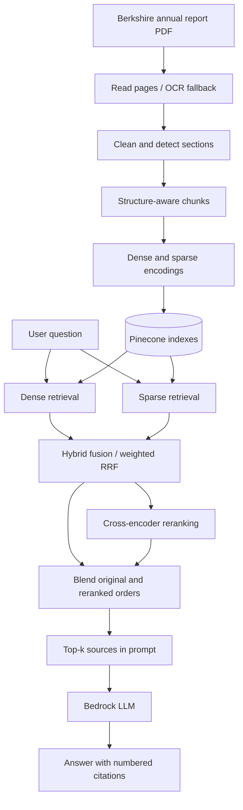

# RAG Engineering Glossary — From PDF to Grounded Answer

> A beginner-friendly, codebase-grounded guide using the Berkshire Hathaway 2025 annual report. Every term answers three questions: **What is it? Why do we need it? What does it look like here?**

**Running example:** “Does Berkshire Hathaway pay a cash dividend?” This question appears in `backend/evals/golden.json`.

## The big picture

**Two independent phases:** ingestion prepares searchable data; retrieval and generation run when a user asks a question.

## 1. Preparing the PDF

### 1. Ingestion
**What:** Importing and processing a document so the system can search it later.
**Why:** The LLM cannot efficiently search a whole collection of raw PDFs on every question.
**Here:** `IngestionService` reads the Berkshire PDF, cleans pages, discovers sections, chunks text, embeds chunks, and writes them into Pinecone. See `backend/src/rag_system/ingestion/pipeline.py`.

### 2. Text extraction
**What:** Reading actual characters already stored in a digital PDF.
**Why:** It is generally faster and retains layout cues without image recognition.
**Here:** `pypdfium2` extracts characters, font weight, sizes and positions from digital report pages (`ingestion/pdf_reader.py`).

### 3. OCR — Optical Character Recognition
**What:** Recognizing words inside an image of a document.
**Why:** A scanned page may have no usable text layer.
**Here:** If a page has too little extracted text **and** contains an image, it is rendered as PNG and sent to **AWS Textract `DetectDocumentText`**. Blank pages do not trigger OCR. This returns text lines, not reliable table cells. See `clients/textract.py`.

### 4. Cleaning
**What:** Removing extraction noise such as repeating headers, page numbers and broken words.
**Why:** Noise wastes embedding capacity and can make unrelated chunks look similar.
**Here:** The cleaning stage removes repeating headers/footers and joins hyphenated words before structuring the report (`ingestion/cleaning.py`).

### 5. Section detection
**What:** Identifying headings and hierarchical parts of a document.
**Why:** A financial number needs the heading, year and accounting context around it.
**Here:** PDF bookmarks plus styled heading lines identify paths such as `FORM 10-K > Item 7 ... > Insurance—Underwriting`. See `ingestion/structure.py`.

### 6. Chunking
**What:** Breaking a long document into smaller searchable pieces.
**Why:** Retrieving one relevant section is cheaper and more precise than sending a 154-page report to the LLM.
**Here:** The README reports **461 chunks** from the Berkshire report. Each chunk belongs to one section (`ingestion/chunking.py`).

### 7. Structure-aware chunking
**What:** Splitting by meaningful sections, paragraphs and tables rather than cutting text at arbitrary positions.
**Why:** A sentence about dividend policy should not be merged into an unrelated topic; table values should retain column labels.
**Here:** Small sections remain intact; larger sections split between blocks; oversized tables split between rows with headings repeated. When OCR lacks layout/font information, section detection is less precise.

### 8. Chunk overlap
**What:** Repeating a small tail of text across adjacent chunks.
**Why:** A relevant explanation might cross a chunk boundary.
**Here:** Consecutive paragraph chunks from the same section may overlap; table rows are not repeated as overlap.

### 9. Metadata
**What:** Context stored alongside chunk text, such as document name, section, page range and chunk ID.
**Why:** It helps users verify citations and helps developers evaluate retrieval.
**Here:** The `Chunk` model records `document_name`, `section`, `page_start`, `page_end` and ID.

## 2. Making content searchable

### 10. Embedding
**What:** A numeric representation of text learned by an embedding model.
**Why:** Numerically similar representations can help retrieve similar meanings even when wording differs.
**Example:** “Does Berkshire distribute profits?” and “Berkshire has not declared a cash dividend…” may be semantically related, although they share few words.
**Here:** Pinecone Inference's `llama-text-embed-v2` creates dense embeddings. A toy vector like `[0.12, -0.45, 0.81]` is **illustrative**, not a model output.

### 11. Bi-encoder
**What:** Encodes a query and a document independently, then compares their representations.
**Why:** We can precompute document vectors once instead of running a large model for every query/document pair.
**Here:** Document text is embedded during ingestion, while the question is embedded at search time.

### 12. Vector database
**What:** Storage that supports searching for similar numerical vectors.
**Why:** Comparing a query against every stored chunk manually is inefficient at large scale.
**Here:** Pinecone stores and searches the report's dense vectors; a separate sparse index supports exact-term retrieval.

### 13. Cosine similarity
**What:** A measure of how closely two vectors point in the same direction.
**Why:** It is a common way to rank semantic similarity.
**Example:** A query about dividends should be closer to the dividend-policy text than to unrelated railroad operating details.
**Note:** The dense store uses vector similarity; the exact metric must be checked against its index configuration rather than assumed for every deployment.

### 14. ANN — Approximate Nearest Neighbor
**What:** Indexing/search algorithms that quickly find likely nearest vectors without exhaustive comparison.
**Why:** They make similarity search practical over large collections, at a possible cost in exact recall.
**Here:** Pinecone manages search infrastructure; the repository does **not** directly configure a specific ANN algorithm such as HNSW.

## 3. Finding evidence for a question

### 15. Dense search
**What:** Retrieval by semantic meaning through dense vectors.
**Why:** Users paraphrase; they rarely phrase questions exactly like the source text.
**Example:** “Does Berkshire distribute profits to owners?” can find material discussing cash dividends.
**Here:** `DenseRetriever` embeds the query and searches the dense index.

### 16. Sparse search
**What:** Retrieval using a large, mostly-zero representation of weighted terms/features.
**Why:** Exact strings such as `1.125% Senior Notes` may matter more than broad semantic similarity.
**Example:** “When are the 1.125% Senior Notes due?” benefits from preserving those exact terms.
**Here:** We use `pinecone-sparse-english-v0`; this is learned sparse retrieval, **not BM25**.

### 17. BM25
**What:** A classic keyword-ranking algorithm that rewards informative matching terms and accounts for term frequency/document length.
**Why:** It is a strong baseline for exact-word retrieval.
**Here:** A useful comparison candidate, **not** the sparse encoder used by this repository.

### 18. Hybrid search
**What:** Running dense and sparse retrieval together.
**Why:** Dense helps with paraphrases; sparse helps with exact terms and identifiers.
**Here:** `HybridRetriever` runs both searches in parallel and combines their ranked lists.

### 19. RRF — Reciprocal Rank Fusion
**What:** Combining ranked lists using **positions**, not directly adding incompatible similarity scores.
**Why:** Dense similarity and sparse scores need not have the same numerical scale.
**Toy example:** Dense ranks `Dividend Policy` #1 and sparse ranks it #2; RRF rewards its strong position in both lists.

Formula: `RRF(chunk) = sum(weight_for_list / (k + rank_in_list))`. A missing chunk contributes zero in that list.

**Here:** The experimental hybrid configuration uses **k=1**, dense weight **1**, sparse weight **0.5**. The code also defines the conventional default `RRF_K=60`, so distinguish configured experiments from code defaults.

### 20. Top-K
**What:** The highest K results retained after ranking.
**Why:** Larger K improves the chance of containing evidence but adds noise, latency and context cost.
**Example:** Top-5 retains five chunks for answer generation; reranking can first examine a wider pool such as 20 candidates.

## 4. Deciding which chunks deserve top positions

### 21. Reranking
**What:** Scoring retrieved candidate chunks again and reordering them.
**Why:** Initial retrieval is optimized for finding candidates quickly, not necessarily perfect ranking.
**Here:** `RerankingRetriever` gets a broader candidate list and applies a reranker.

### 22. Cross-encoder
**What:** A model that reads a **question and one chunk together** to judge relevance.
**Why:** Joint reading can capture precise interactions missed by independent vector encodings.
**Toy example:** `question + Dividend Policy → relevance score`; repeat for every candidate.
**Here:** The README documents `bge-reranker-v2-m3` on the top 20 candidates. This is different from calculating cosine similarity between two precomputed embeddings.

### 23. Pure reranking
**What:** Discarding the original candidate order and using the cross-encoder's order entirely.
**Why it can break:** The reranker may prefer lexical matches and demote a good paraphrase.
**Here:** The experiments show strong improvements in first-result quality but some paraphrase regressions.

### 24. Blended reranking
**What:** Combining the original retrieval order with the cross-encoder order.
**Why:** Preserve valuable semantic/keyword retrieval signals when the reranker makes a poor judgment.
**Here:** Weighted RRF blends **hybrid order (weight 1)** with **reranker order (weight 2)**; this is not averaging their raw scores.

**Important limit:** A reranker, pure or blended, cannot recover a relevant chunk that was never included among its candidates.

## 5. Writing the answer

### 25. Context assembly
**What:** Packaging selected chunks and their source information into the LLM request.
**Why:** The LLM needs both the relevant evidence and a way to identify it.
**Here:** `answering.py` sends numbered source blocks with document name, section and page range.

### 26. Grounding
**What:** Asking the LLM to answer from supplied evidence, not unsupported guesses.
**Why:** A plausible answer without evidence may be wrong.
**Here:** The system prompt requires source-based factual sentences, exact units/periods and a clear admission when evidence is missing.

### 27. Citation
**What:** A reference linking an answer claim to its supporting source.
**Why:** Readers can check the report rather than simply trusting the model.
**Here:** Answers cite numbered sources like `[1]`; citations help verification but do not automatically prove correctness.

### 28. Hallucination
**What:** An incorrect or unsupported claim generated by the LLM.
**Example:** Inventing a dividend payment date not supported by the Berkshire report.
**Mitigation here:** Retrieved evidence, citation instructions and an explicit rule to abstain if the evidence is insufficient. These reduce risk but do not eliminate it.

## 6. Proving the system improved

**Golden dataset:** Questions with labeled expected facts and supporting pages/sections. `backend/evals/golden.json` contains **58** questions: **52 answerable**, **6 unanswerable**.

**Tune split:** Questions used to choose retrieval settings, such as sparse weight and RRF k.

**Held-out test split:** Questions not used to tune those settings; they estimate whether improvements generalize.

| Metric | Easy meaning | Mini-example |
|---|---|---|
| **Hit@5** | Did at least one relevant result appear in the first five? | Yes → 1 for that question |
| **Recall@5** | What share of all required evidence items did we find? | Found 1 of 2 facts → 50% |
| **Precision@5** | How many of the first five chunks support required evidence? | 2 useful chunks of 5 → 40% |
| **MRR** | How early is the first relevant result? | First relevant at rank 2 → reciprocal rank 0.5 |
| **nDCG@5** | Did we find **distinct required evidence** early? | Evidence at rank 1 is rewarded more than at rank 5 |
| **p50 / p95 latency** | How long do the median and 95th-percentile requests take? | p95 reflects slower-tail behavior |

These definitions follow the repository's `evaluation.py`: evidence is checked against source page/section labels, not exact chunk IDs.

For what each test checks, worked metric examples and the limits of the evaluation, see
[EVALUATION.md](EVALUATION.md).

### Our reported held-out evaluation

Results below are **reported in the README**, not independently rerun here. The held-out split contains **33 answerable questions**, evaluated at k=10 and summarized at Hit@5:

| Experiment | Hit@1 | Hit@5 | MRR | Approx. p50 retrieval latency |
|---|---:|---:|---:|---:|
| Dense only | 61% | 79% | 0.690 | 600 ms |
| Tuned hybrid | 58% | 91% | 0.697 | 590 ms |
| Hybrid + pure rerank | 70% | 91% | 0.778 | 1,500 ms |
| **Hybrid + blended rerank** | **70%** | **97%** | **0.790** | **1,300 ms** |

**The learning sequence:**

1. Dense search understood meaning but missed some exact financial evidence.
2. Adding sparse search improved finding evidence in top five; the first result became slightly worse.
3. Pure cross-encoder reranking improved ordering but sometimes hurt paraphrases.
4. Blending the two rankings preserved useful retrieval signals and improved held-out Hit@5.
5. Results differ by question type; table-number queries remain harder than prose facts. Evaluate each change rather than assuming more components are always better.

## Where to read the code

| Stage | Source |
|---|---|
| Extract PDF and OCR fallback | [`ingestion/pdf_reader.py`](../backend/src/rag_system/ingestion/pdf_reader.py), [`clients/textract.py`](../backend/src/rag_system/clients/textract.py) |
| Find sections and chunks | [`ingestion/structure.py`](../backend/src/rag_system/ingestion/structure.py), [`ingestion/chunking.py`](../backend/src/rag_system/ingestion/chunking.py) |
| Ingest into indexes | [`ingestion/pipeline.py`](../backend/src/rag_system/ingestion/pipeline.py) |
| Dense, sparse, hybrid, rerank, blend | [`retrieval.py`](../backend/src/rag_system/retrieval.py) |
| Prompt and citation formatting | [`answering.py`](../backend/src/rag_system/answering.py) |
| Golden questions and metrics | [`golden.json`](../backend/evals/golden.json), [`evaluation.py`](../backend/src/rag_system/evaluation.py) |

---

**Mental model:** *Read the document → preserve its structure → make evidence searchable → find candidates by meaning and terms → rank carefully → answer from sources → measure whether it worked.*
