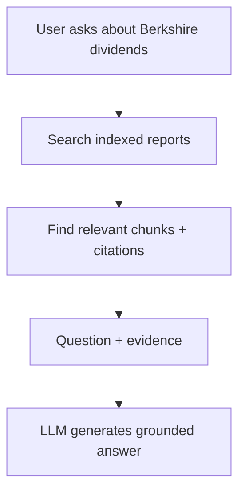
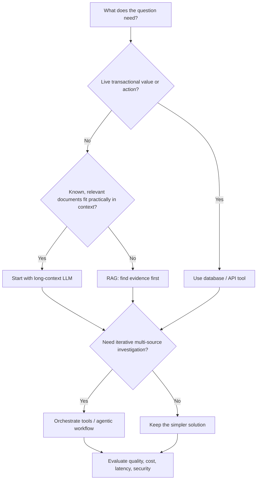

# Why Do We Need RAG in the First Place?

> A first-principles guide to choosing **LLMs, long context, RAG, databases/APIs, and agents**. The goal is to **derive the design from the problem**, not default to RAG because it is fashionable.
>
> **Core distinction:** A context window determines **how much information a model can process in one request**. Retrieval determines **which information should be supplied**. These solve overlapping but different problems.

## 1. Start with the simplest solution: ask an LLM

Imagine asking:

> "Does Berkshire Hathaway pay a cash dividend?"

A pretrained LLM may know something about Berkshire. Why not ask it directly?

**What works:** General knowledge, writing, brainstorming, common explanations.

**What breaks:** The question may require an exact figure, a specific reporting year, a recently updated policy, or a citation from **our** annual report. Model training knowledge is not a reliable versioned lookup of the document. A confident answer is not necessarily grounded.

**First improvement:** Give the model the relevant source document as part of the request.

```text
Question + source document → LLM → source-grounded answer
```

This is **grounding with provided context**, even if there is no retrieval pipeline.

## 2. Why not simply put the entire PDF in the prompt?

For a single Berkshire annual report, this can be a good solution.

**Long-context LLM:** A model capable of processing a large input containing many pages or documents.

**Example:** To summarize the report as a whole, supply the full report (if the model, format, and effective context capacity permit). This helps the model understand relationships spread across sections.

**What breaks as the corpus grows?**
- **Scale:** One PDF may fit; millions of annual reports, policies, and internal documents will not fit in a practical request.
- **Repeated cost:** Re-sending the same huge context for every question can cost time and money; caching can reduce this but has its own constraints.
- **Signal-to-noise:** Relevant evidence gets buried among irrelevant pages; larger windows do not guarantee the model uses every fact correctly.
- **Freshness:** Updated documents still need to be supplied correctly.
- **Access control:** Different users may be entitled to different documents.
- **Traceability:** You still need explicit, checkable sources and version details.

A larger context window **moves the boundary** where retrieval becomes useful; it does not erase these problems.

## 3. RAG is a selection strategy, not a replacement for the LLM

**RAG = Retrieval-Augmented Generation.** Find external evidence and supply it to a model when generating an answer.



**Why it helps:** Instead of sending everything, we send the **best candidates**. Retrieval is a relevance and cost-control mechanism, not magic truth verification.

**New failure:** If retrieval misses the right passage, the LLM may not be able to answer, no matter how capable it is.

**Trade-off:** Additional ingestion, indexes, ranking, evaluation, operational complexity, and potential omissions.

### What our repository actually does

Our [RAG System](../README.md) reads the Berkshire annual report, extracts pages (with OCR fallback for scanned pages), builds section-aware chunks, encodes them into Pinecone dense and sparse indexes, and retrieves candidates. It optionally fuses dense/sparse rankings, reranks candidates, and sends source-labeled chunks to the answer model.

See: [Glossary](RAG_GLOSSARY.md) · [Implementation journey](JOURNEY.md) · [Evaluation](EVALUATION.md).

**Important:** The project demonstrates retrieval and grounding on a document corpus. It does **not** prove that this pipeline beats a long-context model for *every* Berkshire question. That requires a controlled comparison.

## 4. Four approaches, four jobs

| Approach | Primary question it answers | Berkshire / enterprise example |
|---|---|---|
| **LLM from training** | "Can the model explain this using what it already learned?" | Explain what a cash dividend is |
| **Long-context LLM** | "Can I give the model the complete relevant material now?" | Summarize or compare sections of one annual report |
| **RAG** | "Which evidence should we locate in a large, evolving collection?" | Answer across thousands of annual reports with page citations |
| **Database/API/tool call** | "What is the authoritative live state or exact computation?" | Fetch a current account balance or today's order status |
| **Agentic workflow** | "Which steps or sources do we need, and should we iterate?" | Investigate an issue across docs, tickets, metrics, and APIs |

**Not mutually exclusive:** A production agent can use RAG search, SQL, APIs, and long-context reasoning in the *same workflow*.

## 5. Choose by the failure mode, not by hype

### Case A: Summarizing one 100-page PDF

**Start:** Put the PDF into a long-context-capable model.

**Why:** Summaries may depend on the entire document, and retrieval could omit important sections.

**Upgrade only if:** It is too large, too expensive, frequently reused, or you need precise, repeatable page-level lookup.

### Case B: Answering questions about 10 million technical documents

**Start:** Search/index + RAG (with version, product, and permission filters).

**Why:** The documents cannot all be sent to the model on every query.

**New failure:** Ranking may retrieve wrong product versions or omit relevant passages. Evaluate recall and metadata-filter false negatives.

### Case C: Comparing three contracts in detail

**Start:** Use long context if the documents fit and the analysis needs them in full.

**Why:** Clause-to-clause comparisons can fail if retrieval silently excludes clauses.

**Upgrade:** Use retrieval for locating candidate clauses, then provide full selected sections for reasoning.

### Case D: "Where is my order right now?"

**Start:** Call the authoritative order-status API or database.

**Why:** Similar text from a vector index is not a reliable current transaction state.

**RAG's role:** Might explain shipping policy, not determine the live order status.

### Case E: "Our customers report login failures after yesterday's release. Why?"

**Start:** An agentic workflow or explicit orchestration that queries release notes, Jira, logs, and metrics.

**Why:** No single document necessarily contains the answer; the system needs multiple dependent lookups and comparisons.

**RAG's role:** Retrieve relevant documentation and historical incidents as one tool among others.

### Case F: Berkshire's dividend policy

**Option 1 — Long context:** Supply the annual report and ask for its dividend policy with exact citations.

**Option 2 — Our RAG:** Index once and retrieve the policy section for repeated questions.

**What to compare:** Evidence recall, factual correctness, citation accuracy, p50/p95 latency, cost per query, and ingestion costs amortized over query volume.

**Takeaway:** For a single report and occasional questions, a standalone long-context approach can be simpler. For many reports and frequent queries, RAG may be more economical and easier to search.

## 6. Decision tree (derive the architecture)



**Additional constraints that may change the answer:** document permissions, freshness requirements, privacy/data residency, volume of requests, latency budget, factual error tolerance, and source citation requirements.

## 7. How to test "RAG vs long context" fairly in our repo

This is a **proposed experiment**, not an evaluation already completed.

Use the **same Berkshire PDF, the same model, and the same held-out questions**.

| Variant | Model input | What it tests |
|---|---|---|
| A. Model alone | Question only | How much comes from model training (not reliable document grounding) |
| B. Full context | Question + complete PDF text (if it fits) | Long-context-only grounding |
| C. Dense RAG | Question + top-K dense chunks | Basic retrieval |
| D. Advanced RAG | Question + hybrid / blended-reranked chunks | Our current retrieval enhancements |
| E. Hybrid | Question + retrieved full relevant sections | Whether retrieval + longer local context helps |

**Keep constant:** model, temperature, prompt requirements, document version, expected facts, and test questions. Account for token limits and cache behavior explicitly.

**Measure:**
- **Answer correctness**: Are required Berkshire facts, numbers, units, and periods correct?
- **Evidence/citation correctness**: Does each cited page support the claim?
- **Retrieval recall** (RAG variants): Did we retrieve the required evidence?
- **Abstention**: Does the system decline unsupported answers?
- **Cost**: Input/output tokens + retrieval/reranking + amortized ingestion.
- **Latency**: p50 and p95, including generation and any indexing setup separately.
- **Scalability**: Repeat with 1, 10, 100, and more documents; include warm and cold cache cases.

Do **not** equate a high Hit@5 with a correct final answer: retrieval quality and answer quality are different measures.

### Example hypotheses worth testing

1. **One-off whole-document summary:** Full context will likely be simpler and may retain more global information.
2. **Repeated narrow fact questions:** RAG may reduce input size and per-query cost while retaining sufficient evidence.
3. **Tables and exact financial numbers:** Better parsing, source selection, and verification may matter more than a bigger embedding model.
4. **Multiple reports and versions:** Metadata/version filters should become more valuable as ambiguity increases.
5. **Multi-hop questions:** One-shot retrieval may miss evidence needed for a second, dependent lookup.

Hypotheses are **not results**: measure them instead of assuming they hold.

## 8. "RAG is dead" — what is actually changing?

A useful way to understand the claim:

- **Naive RAG:** Chunk PDFs → vector search → paste top five chunks → LLM. It can fail on exact terms, multi-hop reasoning, tables, versioning, and citations.
- **Improved RAG:** Structure-aware chunking, metadata filters, sparse + dense search, reranking, and systematic evaluation.
- **Agentic retrieval:** Decide when to search, choose sources/tools, inspect retrieved evidence, and search again when needed.
- **Long context:** Reduces the need for retrieval when relevant material fits and can be processed accurately.

None of these makes the other universally obsolete.

**Principle:** Don't add RAG to every LLM app. Add it when **selecting the right external evidence** is the problem.

## 9. Learning checklist

When designing a system, ask:

1. What is the simplest viable approach with no vector database?
2. Is the needed data already in the prompt, model knowledge, or a live API?
3. How large and how fast-changing is the source corpus?
4. What breaks if we send all relevant material directly?
5. What do we lose if retrieval omits a crucial passage?
6. Do users have different access rights or product/version scopes?
7. Are agents needed for dependent steps, or would an explicit pipeline suffice?
8. What experiment would prove that extra complexity pays for itself?

## 10. Related reading in this repository

- [RAG Engineering Glossary](RAG_GLOSSARY.md) — terms from extraction to evaluation.
- [Enterprise RAG Learnings](ENTERPRISE_RAG_LEARNINGS.md) — Ring, Audi, Microsoft and KDDI scaling case studies.
- [Our Journey](JOURNEY.md) — design iterations and failures.
- [Evaluation](EVALUATION.md) — dataset, metrics and test approach.
- [Zero-Budget RAG](ZERO_BUDGET_RAG.md) — practical alternatives.

---

**One sentence:** A larger context window helps the model **read more**; RAG helps the system **find what is worth reading**; tools fetch **live truth**; agents coordinate **multi-step work**.
